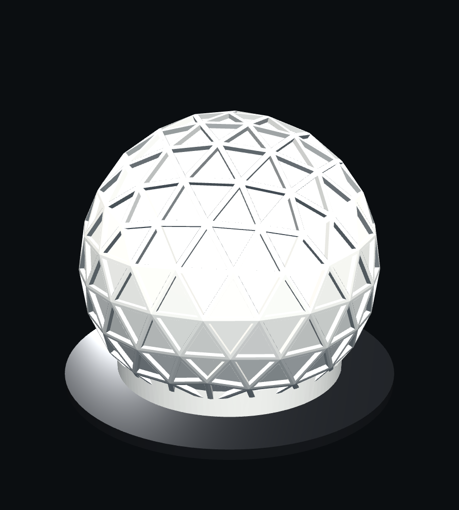
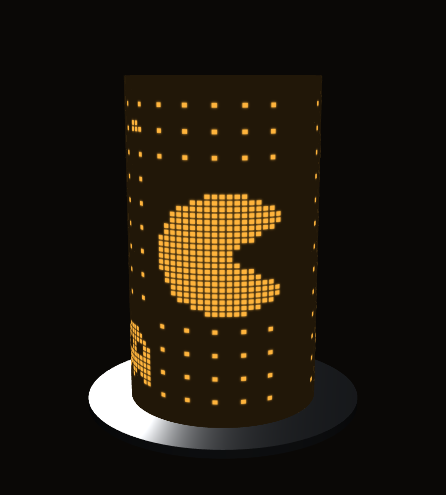
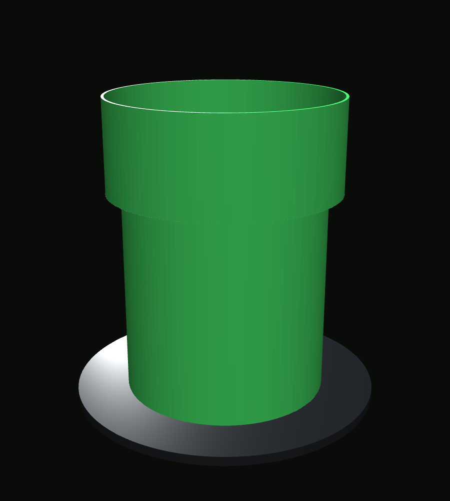

# LightShade

3D-printable shades for an RGB light that sits in a black base ring. The light's chrome ring
measures **82.19 mm OD**. Each shade has an **84.0 mm bore**, which gives about 0.9 mm of
clearance per side. The shade drops over the chrome ring and rests on the black ring.

Both models are parametric [build123d](https://github.com/gumyr/build123d) scripts. All
dimensions are set as named parameters at the top of each file.

## Shades

### Geodesic dome



A frequency-4 geodesic sphere cut flat onto a base collar. It has 0.8 mm translucent panels
between raised struts.

- **Viewer:** [`out/geodesic_shade_viewer.html`](out/geodesic_shade_viewer.html)
  ([shared copy](https://claude.ai/artifact/X6QRciDGakwiVSjTVTLYnA))

| | |
|---|---|
| Height × max diameter | 100.6 × 116.0 mm (3.96 in tall) |
| Panels | 275 triangles, 0.8 mm thick |
| Struts | 2.0 mm wide, 2.6 mm deep, on the outside |
| Collar | 84.0 mm ID, 90.6 mm OD, 10 mm tall |
| Material | 52.8 cm³, about 65 g PLA |
| Supports | Tree supports inside the upper cap, touching the build plate only. They come out through the base opening. |

### Arcade pixel cylinder



A 6-inch tube with a 763-pixel arcade pattern. The pattern comes from
[`patterns/arcade_pixels.svg`](patterns/arcade_pixels.svg), a 90 × 57 cardstock wrap. Each pixel
is a pocket cut into the inside of a 3 mm wall, leaving a 0.8 mm skin. The outside stays smooth,
and the pixels glow through a dark wall.

- **Viewer:** [`out/pixel_cylinder_viewer.html`](out/pixel_cylinder_viewer.html)
  ([shared copy](https://claude.ai/artifact/8NRowLVrYndwGCmYLNB9M8))

| | |
|---|---|
| Height × diameter | 152.4 × 90.0 mm (6.00 in tall), 84.0 mm bore |
| Pixels | 2.25 × 1.93 mm on a 3.14 × 2.67 mm pitch, with 11 mm solid bands at top and bottom |
| Wall thickness | 0.8 mm pixel skin (bright), 3.0 mm wall (dark), 0.85 mm webs between columns |
| Mapping | The 9.425 in wrap goes all the way around, so the seam closes. Height is 1:1, so pixels come out about 18% wider than tall. |
| Material | 117.7 cm³, about 146 g PLA |
| Supports | None. Each pixel ceiling is a 2.3 mm bridge. |

### Green pipe



A thin-walled pipe with a wide top lip, in the style of a classic platformer. Every wall, the
lip included, is a single 1.2 mm layer, so the whole pipe glows evenly. The open top lets light spill up onto the ceiling.

- **Viewer:** [`out/pipe_shade_viewer.html`](out/pipe_shade_viewer.html)
  ([shared copy](https://claude.ai/artifact/JokqEuKjt2GQWV63E5FAQs))

| | |
|---|---|
| Height | 127.0 mm (5.00 in), with a 40 mm lip |
| Diameters | 85.0 mm bore, 87.4 mm body OD, 100.0 mm lip OD |
| Wall | 1.2 mm single layer. Inside the lip, the bore widens through a 45° cone. |
| Material | 50.9 cm³, about 63 g PLA. Use translucent or light green. |
| Supports | None when printed rim-down; add a brim. `out/pipe_shade_print.stl` and the 3MF are already flipped. |

## Printing

- Print the dome and pixel cylinder upright with the collar on the bed. Print the pipe upside down, rim on the bed.
- Use a 0.4 mm nozzle. Print the dome and cylinder in white or natural PLA. Their 0.8 mm skins are exactly two perimeters, so don't add extra walls.

## Repository layout

```
cad/
  geodesic_shade.py     geodesic dome model
  pixel_cylinder.py     arcade pixel cylinder model (reads patterns/arcade_pixels.svg)
  pipe_shade.py         green pipe model
  build_viewer.py       embeds each STL (and the pixel pattern) into its viewer page
patterns/
  arcade_pixels.svg     pixel pattern for the cylinder (90 x 57 grid, inches)
images/
  *.png                 README renders, captured from the viewer pages
web/
  *_template.html       viewer page templates (three.js)
out/
  *.step / *.stl / *.3mf    exported models (generated; edit the scripts, not these)
  *_viewer.html             self-contained 3D viewers (generated)
```

## Rebuilding

```sh
uv run --python 3.12 --with build123d python cad/geodesic_shade.py
uv run --python 3.12 --with build123d python cad/pixel_cylinder.py
uv run --python 3.12 --with build123d python cad/pipe_shade.py
python3 cad/build_viewer.py
```

Each model script writes its STEP and STL files to `out/`. The pipe script also writes a flipped STL for printing. The 3MF files were exported with
the build123d-mcp server.
